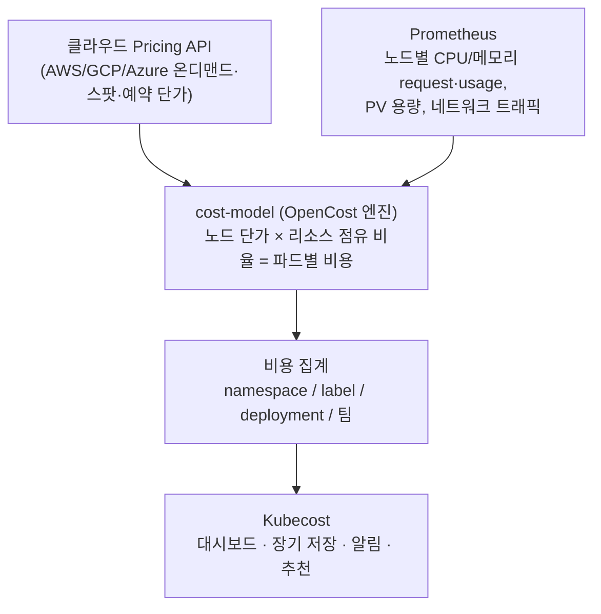
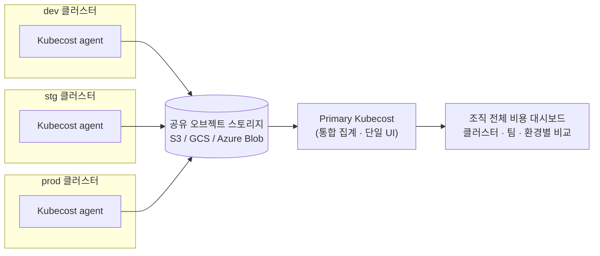

[EKS 관측 플랫폼](/blog/eks-multi-cluster-observability-platform)을 만들고 [Prometheus·Loki·Grafana](/blog/kubernetes-observability-prometheus-loki)까지 올려두니 "지금 뭐가 터졌는지"는 잘 보였다. 그런데 월말에 AWS 청구서를 열면 다른 질문이 남았다 — **이 비용 중에 어떤 클러스터, 어떤 네임스페이스, 어떤 팀이 얼마를 썼는가?** AWS Cost Explorer는 계정·서비스(EC2, EBS, …) 단위로만 비용을 쪼개주기 때문에, 노드 하나에 파드 수십 개가 뒤섞여 도는 쿠버네티스 안에서는 이 질문에 답을 못 한다. 클러스터가 dev·stg·prod로 여러 개로 늘어나면 문제는 더 커진다. 클러스터마다 따로 들어가서 숫자를 합산해야 하기 때문이다.

이 문제를 한 번에 푸는 도구가 **Kubecost**다. 그리고 그 안에서 비용을 계산하는 엔진이 **OpenCost**다.

## Kubecost가 해결하는 문제

Kubecost를 쓰는 이유는 크게 네 가지다.

1. **쿠버네티스 안쪽의 비용 가시성** — 노드가 아니라 네임스페이스·디플로이먼트·레이블·파드 단위로 비용을 본다.
2. **여러 클러스터를 한 화면에서** — 클러스터별로 들어가지 않고 조직 전체 비용을 합쳐서 본다.
3. **쿠버네티스 비용 + 클라우드 비용을 함께** — 클러스터 밖의 S3, RDS, 데이터 전송 같은 비용도 같은 화면에서 본다.
4. **보기만 하지 않고 줄이는 데까지** — 낭비 탐지, 사이징 추천, 예산 알림이 같이 따라온다.

## 비용을 어떻게 계산하나 — cost-model의 동작 원리

Kubecost의 계산 원리는 단순하다. 클라우드 가격을 쿠버네티스 리소스 사용량에 곱해서 파드·네임스페이스·레이블 단위로 쪼갠다.



핵심은 **노드 하나의 시간당 가격을, 그 노드 위에서 돈 파드들의 CPU/메모리 점유 비율대로 나눠 담는다**는 것이다. 예를 들어 `m5.xlarge` 노드가 시간당 $0.192인데, 그 위에 파드 A가 전체 CPU request의 30%, 파드 B가 20%를 쓰고 있다면 A는 노드 비용의 30%, B는 20%를 떠안는 식이다. 네트워크·스토리지(PV)·로드밸런서 비용도 같은 방식으로 쪼개서 더한다.

이 비율을 매길 때 **request 기반**으로 할지 **실제 usage 기반**으로 할지가 중요하다. request를 넉넉하게 잡아두고 실제로는 거의 안 쓰는 파드는 **idle cost**로 따로 표시되는데, 이 값이 크다는 건 리소스를 과다 할당했다는 신호다.

## Kubecost의 핵심 기능

### 1. Allocations — 누가 얼마나 썼나

가장 기본이 되는 화면이다. 네임스페이스, 컨트롤러(Deployment/StatefulSet), 파드, 컨테이너, **레이블**, 팀 단위로 비용을 집계하고 CPU·메모리·스토리지·네트워크·GPU별로 쪼개서 보여준다.

여기서 실무적으로 가장 쓸모 있는 건 **레이블 기반 집계**다. 워크로드에 `team=backend`, `env=prod` 같은 레이블을 일관되게 붙여두면, "백엔드 팀이 이번 달 prod에서 얼마를 썼나"를 레이블 하나로 바로 뽑을 수 있다. 팀별 **showback**(보여주기)과 **chargeback**(청구하기)을 할 때 이 데이터를 그대로 쓴다.

공유 비용 배분도 지원한다. `kube-system` 같은 공통 네임스페이스나 모니터링 스택의 비용을 "사용자 워크로드에 비례해서 나눠 담기" 또는 "균등 분배"로 설정할 수 있어서, 사용자 워크로드 합계와 실제 노드 비용이 안 맞는 문제를 정리할 수 있다.

### 2. 멀티클러스터 통합 모니터링

클러스터가 여러 개일 때 Kubecost의 가치가 가장 크게 드러난다. 클러스터마다 Kubecost를 따로 열어보는 대신, **각 클러스터가 비용 데이터를 공유 저장소(예: S3)에 올리고, 중앙에서 그걸 합쳐서 하나의 대시보드로 보여주는** 구조다. 이 방식을 Federated ETL이라고 부른다.



이렇게 구성하면 얻는 게 분명하다.

- **한 화면에서 클러스터 비교** — dev 대비 prod가 몇 배인지, 어느 클러스터의 idle cost가 높은지를 나란히 본다.
- **클러스터를 가로지르는 집계** — 같은 `team=backend` 레이블이 dev·stg·prod 세 클러스터에 흩어져 있어도 팀 단위로 합산된다.
- **멀티 클라우드까지** — EKS와 AKS, GKE 클러스터가 섞여 있어도 같은 방식으로 모은다.
- **장기 보존** — 비용 데이터가 Prometheus가 아니라 오브젝트 스토리지에 쌓이기 때문에, 보존 기간 제약 없이 월 단위·분기 단위 트렌드를 볼 수 있다.

멀티클러스터 통합 집계는 Kubecost의 상위 플랜 기능이다. 플랜별 제약(클러스터 수, 코어 수, 보존 기간)은 버전에 따라 바뀌므로, 도입 전에 공식 문서의 최신 기준을 확인해야 한다.

### 3. Cloud Costs — 쿠버네티스 밖의 비용까지 한 화면에

쿠버네티스 비용만 보면 전체 그림이 안 나온다. 실제 청구서에는 클러스터 밖의 S3, RDS, ElastiCache, NAT Gateway, 리전 간 데이터 전송 비용이 꽤 큰 비중으로 들어 있다.

Kubecost는 클라우드 청구 데이터(AWS는 **CUR, Cost and Usage Report**)를 연동해서 이런 비용을 같은 화면으로 가져온다. 그러면 두 가지가 가능해진다.

- **실제 청구서와 대조** — Kubecost가 추정한 비용과 실제 청구된 금액을 맞춰본다. 예약 인스턴스·Savings Plans·스팟 할인이 적용된 **실제 단가**로 보정되기 때문에, 온디맨드 가격으로 계산한 추정치보다 정확해진다.
- **통합 뷰** — "prod 클러스터 노드 비용 + 그 클러스터가 쓰는 RDS + S3 + 데이터 전송"을 하나의 서비스 단위로 묶어서 본다. 쿠버네티스 비용과 클라우드 비용을 따로 보지 않아도 된다.

결국 Cost Explorer는 "어떤 AWS 서비스가 비싼가"를, Kubecost는 "어떤 워크로드·팀이 비싼가"를 답해주는데, 이 둘을 한 곳에서 겹쳐 볼 수 있다는 게 통합 모니터링의 의미다.

### 4. Savings — 보는 데서 끝나지 않고 줄이기

Kubecost는 비용을 보여주는 데서 끝나지 않고 **어디를 줄일 수 있는지**까지 짚어준다.

| 추천 항목 | 하는 일 |
|---|---|
| Right-sizing (컨테이너) | 실제 사용량 대비 request가 과한 컨테이너를 찾아 적정 값을 제안 |
| Right-sizing (노드) | 노드 유형·개수가 워크로드에 비해 과하거나 부족한지 분석 |
| Abandoned workloads | 트래픽이 거의 없는 방치된 워크로드 탐지 |
| Unclaimed volumes | 어느 파드에도 붙지 않은 PV 등 쓰이지 않는 스토리지 |
| Orphaned resources | 연결 대상이 사라졌는데 과금되는 디스크·IP·로드밸런서 |
| Reserved/Savings Plan | 예약 인스턴스·Savings Plans 구매 추천 |

특히 **right-sizing**이 체감이 크다. 개발팀이 "혹시 모르니까" 넉넉하게 잡아둔 request가 클러스터 전체에서 모이면, 노드 몇 대분의 낭비가 된다. Kubecost는 그걸 팀과 워크로드별 숫자로 보여주기 때문에, "이 디플로이먼트 request를 줄이면 월 얼마 절약"이라는 근거를 들고 이야기할 수 있다.

### 5. Alerts·Reports — 터지기 전에 알기

- **예산 알림** — 팀·네임스페이스·클러스터 단위로 예산을 정하고 임계치를 넘으면 알림을 보낸다.
- **이상 비용 탐지** — 평소 대비 갑자기 튀는 비용(예: 잘못 배포된 GPU 워크로드, 무한 스케일아웃)을 감지한다.
- **정기 리포트** — 주간·월간 비용 요약을 Slack, Teams, 이메일로 보낸다.
- **Health·Efficiency 점수** — 클러스터의 자원 효율을 점수화해서 개선 전후를 비교한다.

비용 사고는 대개 "월말 청구서에서 처음 발견"되는데, 알림이 있으면 그 시점이 "당일 또는 다음 날"로 당겨진다.

## OpenCost와는 무엇이 다른가

이름이 비슷해서 "둘 중 하나를 고르는" 문제처럼 보이지만, 실제로는 **포함 관계**다.

- **OpenCost**는 쿠버네티스 비용을 계산하는 핵심 엔진이다. Kubecost 팀이 만들어 2022년에 **CNCF Sandbox 프로젝트로 기부**했고, 지금은 완전히 오픈소스(Apache 2.0)로 운영된다.
- **Kubecost**는 그 OpenCost 엔진을 **내부 코어로 포함**하면서, 위에서 설명한 대시보드·멀티클러스터 집계·클라우드 청구 연동·알림·추천 같은 제품 기능을 얹은 완제품이다.

즉 "엔진 vs 그 엔진을 쓰는 제품"의 비교다. 둘 다 같은 알고리즘으로 비용을 계산하기 때문에 숫자 자체는 거의 동일하고, 차이는 **그 숫자를 어디까지 가공해서 보여주냐**에 있다.

| | OpenCost | Kubecost |
|---|---|---|
| 정체 | 비용 계산 엔진 (CNCF Sandbox, Apache 2.0) | OpenCost 엔진 + 제품 기능 (Free/Enterprise) |
| UI | 최소한의 기본 조회 화면 | 대시보드, 리포트, 알림까지 포함한 풍부한 UI |
| 데이터 보존 | Prometheus 보존 기간에 종속 (보통 2주 내외) | 자체 ETL로 장기 저장, 월·분기 트렌드 조회 |
| 멀티클러스터 | 클러스터마다 단독 실행, 수동으로 모아봐야 함 | Federated ETL로 여러 클러스터를 중앙에서 집계 |
| 클라우드 청구 연동 | 제한적 | CUR 등 연동으로 쿠버네티스 밖 비용까지 통합 |
| 알림·거버넌스 | 없음 | 예산 알림, 이상 탐지, Slack/Teams 연동 |
| 최적화 추천 | 없음 | right-sizing, 방치 리소스, 예약 구매 추천 |
| 적합한 용도 | 단일 클러스터에서 지금 시점의 비용 계산 | 여러 클러스터 비용을 조직 단위로 추적·통제 |

실무 기준으로 정리하면 이렇다. **단일 클러스터에서 "네임스페이스별로 얼마 쓰는지"만 알고 싶다면 OpenCost만으로 충분**하다. 이미 Prometheus가 있는 환경이라면 cost-model 하나만 더 붙이면 되기 때문에 부담이 가장 작다. 반면 **클러스터가 여러 개이고, 몇 달치 트렌드나 팀별 예산 알림, 클라우드 청구서 통합이 필요해지는 순간이 Kubecost로 넘어갈 지점**이다.

## 실제로 붙여보면

Helm으로 설치하고, 이미 `kube-prometheus-stack`이 돌고 있다면 Kubecost가 번들로 올리는 Prometheus 대신 **기존 Prometheus를 재사용**하도록 설정할 수 있다.

```yaml
# kubecost values.yaml (요약)
global:
  prometheus:
    enabled: false          # 번들 Prometheus 대신
    fqdn: http://kube-prometheus-stack-prometheus.monitoring:9090   # 기존 Prometheus 사용
  grafana:
    enabled: false          # 기존 Grafana 사용
kubecostProductConfigs:
  clusterName: prod-cluster
```

멀티클러스터로 가려면 각 클러스터의 Kubecost가 같은 오브젝트 스토리지(S3 버킷)에 비용 데이터를 올리도록 설정하고, 중앙(Primary) 인스턴스가 그걸 읽어 합치게 한다. 이때 **클러스터마다 `clusterName`이 겹치지 않게** 지정해야 대시보드에서 구분된다.

> *(여기에 실제 Kubecost 대시보드 스크린샷 추가 예정)*

## 흔한 함정

- **request 기준 비용과 실제 사용량 비용을 혼동** — 기본 계산은 request 기준이라, request를 널널하게 잡은 팀이 실제로는 거의 안 써도 비용이 크게 잡힌다. "총 비용"만 보지 말고 idle cost를 따로 확인해야 과다 할당을 찾을 수 있다.
- **레이블이 제각각이라 팀별 집계가 안 됨** — `team`, `Team`, `owner`처럼 레이블 키가 섞여 있으면 팀 단위 집계가 깨진다. Kubecost를 켜기 전에 **레이블 규칙부터 통일**해야 한다.
- **멀티클러스터에서 clusterName 중복** — 클러스터 이름이 같으면 집계 시 서로 덮어써서 숫자가 틀어진다.
- **클라우드 청구 연동을 안 하고 추정치만 믿음** — 온디맨드 가격 기준 추정치는 예약·스팟 할인이 반영된 실제 청구액과 차이가 난다. 정확한 숫자가 필요하면 CUR 연동이 필수다.
- **스팟 인스턴스 가격 반영 지연** — Pricing API를 주기적으로 캐시하기 때문에, 스팟 가격이 급변하는 시점에는 과거 가격 기준으로 계산될 수 있다.
- **시스템 데몬셋 비용 배분을 빼먹고 "합이 안 맞는다"고 착각** — `kube-system`의 CNI, 로그 수집기도 노드 비용을 가져간다. 사용자 워크로드 합과 노드 전체 비용이 다른 건 이 공유 오버헤드 때문이므로, 공유 비용 배분 설정으로 정리한다.
- **플랜 제약을 모르고 쓰다가 막힘** — 클러스터 수·코어 수·보존 기간 제한은 버전과 플랜에 따라 다르다. 조직이 커지기 전에 전환 기준을 미리 확인해둔다.

## 정리

| 질문 | 답 |
|---|---|
| Kubecost란 | 쿠버네티스 비용을 네임스페이스·팀·레이블 단위로 쪼개서 보여주고, 멀티클러스터 통합·클라우드 청구 연동·알림·절감 추천까지 제공하는 비용 관리 플랫폼 |
| 멀티클러스터는 어떻게 | 각 클러스터가 비용 데이터를 공유 스토리지에 올리고, 중앙 인스턴스가 합쳐서 단일 UI로 제공 (Federated ETL) |
| Cost Explorer와 차이 | Cost Explorer는 AWS 서비스 단위, Kubecost는 워크로드·팀 단위. CUR 연동으로 둘을 한 화면에서 대조 |
| 비용은 어떻게 쪼개나 | 노드 시간당 가격 × 파드별 리소스(CPU/메모리/스토리지/네트워크) 점유 비율 |
| OpenCost와 관계 | OpenCost는 코어 엔진, Kubecost는 그 엔진을 포함한 제품. 계산 결과는 거의 동일 |
| 언제 OpenCost로 충분한가 | 단일/소수 클러스터에서 지금 시점의 네임스페이스별 비용만 보면 될 때 |
| 언제 Kubecost가 필요한가 | 멀티클러스터 집계, 장기 트렌드, 청구서 통합, 팀별 예산 알림, 절감 추천이 필요할 때 |

한 줄 요약: **Kubecost는 "클러스터가 몇 개든 한 화면에서, 쿠버네티스 안팎의 비용을 팀·워크로드 단위로 보고 줄이는" 도구다. OpenCost는 그 안의 계산 엔진이라 단일 클러스터의 현재 비용만 볼 땐 충분하지만, 멀티클러스터 통합과 장기 관리로 넘어가는 순간 Kubecost의 제품 기능이 필요해진다.**
